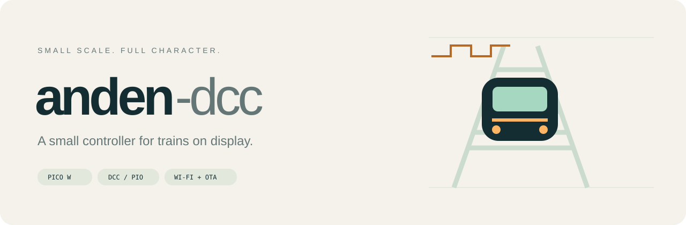

# anden-dcc

## Garantía de humo mágico

**Úsalo bajo tu propio criterio y riesgo.** Es un proyecto de aficionado,
ofrecido tal cual y sin garantía. Si libera el humo mágico de tu Pico, puente H,
decóder o locomotora favorita, enhorabuena: has descubierto el efecto especial
menos útil del modelismo ferroviario. Los autores no se hacen responsables del
hardware dañado, las tardes descarriladas ni del humo que se niegue a volver al
chip. El sentido común y los electrones de repuesto los pones tú.

---

Una pequeña central para un diorama H0, con **Raspberry Pi Pico W**, control web,
Wi-Fi y OTA. La interfaz arranca en inglés; **ES** cambia al español y recuerda
la preferencia en ese navegador.

**Versión 0.5.3:** F0/luces y direcciones cortas 1–127. Los pulsos DCC de 3,3 V
en GP2 se midieron en la versión de una locomotora; la nueva planificación DMA
para varias locomotoras está pendiente de captura física.
**Todavía no se habilita la potencia ni el movimiento**.
El circuito de potencia está documentado como propuesta, pendiente de montaje,
pruebas y firmware de protección.

1. Conecta a `anden-dcc` y abre `http://192.168.42.1`.
2. Abre **Configuración**, introduce tu Wi-Fi de 2,4 GHz y guarda.
3. Vuelve a tu red y abre `http://anden-dcc.local` o la IP de la Pico.
4. Usa **Editar** para dar nombre y dirección a cada locomotora; controla sus luces F0 por separado.
5. **Añadir locomotora** amplía la lista hasta ocho tarjetas.
6. Los archivos `.bin` se instalan en **Configuración → Actualizar firmware**.

**Ilustraciones de locomotoras:** en **Editar**, elige Eléctrica, Diésel o Vapor
con vista previa. Los dibujos SVG se inspiran en RENFE 269, 333 y Santa Fe 151.
El tipo se guarda en la central; cambiarlo no altera la dirección ni las luces.

**Buscar una dirección:** elige un rango de 1 a 127 (por defecto 1-100) y
responde observando las luces de la misma locomotora. La central verifica primero
el rango, lo divide y confirma el resultado antes de añadirlo a las tarjetas.
Cada prueba espera cuatro segundos; puedes repetir o cancelar. Tras tres minutos
sin respuesta se apaga el rango y se restauran las luces solicitadas en las tarjetas.
No programa CV ni admite direcciones largas o luces en modo de 14 pasos.
La búsqueda ya produce señal lógica; la prueba con luces espera la etapa de potencia.

**Montaje simplificado:** una salida del L298P alimenta ambas vías en paralelo;
cada locomotora mantiene sus controles independientes por dirección. Conservamos
dos opciones: **A**, shield sin modificar con adaptador 74AHCT125; y **B**,
retirar el CD4077 y usar dos señales complementarias de la Pico directamente.
La programación de decóderes se ha retirado: las direcciones se obtendrán por otro método.
[Esquema de una hoja](docs/hardware/schematic.pdf) · [Materiales](docs/hardware/BOM.md).
La habilitación de potencia y el corte por corriente en firmware aún están
pendientes de implementación y pruebas.

La lista empieza con dos tarjetas (direcciones 3 y 4): ajústalas a tus decóderes.
Los nombres y direcciones se guardan en la Pico y se comparten entre navegadores.
Todas las locomotoras reciben sus paquetes F0 aunque cierres la página. Al
reiniciar, las luces empiezan apagadas. Al cambiar de dirección también; renombrar
conserva F0. Al eliminar o cambiar de dirección, el decodificador anterior
conserva su último estado: apaga sus luces antes si lo deseas.

Configuración está cerrada por defecto. El LED queda fijo conectado, parpadea
sin conexión y hace un pulso por peticiones de usuario; el sondeo automático de
estado no provoca ese pulso.

Para medir: **D0 → GP2/pin físico 4**, **GND → pin físico 3**. No conectes el
analizador directamente a una vía alimentada. Dirección 3: F0 apagado `03 80 83`;
encendido `03 90 93`.

- [README y compilación](README.md)
- [Elegir entre las dos versiones de hardware](docs/hardware/README.md)
- [Opción A: shield sin modificar y adaptador de nivel](docs/hardware/buffered-shield.md)
- [Opción B: retirar CD4077 y conectar la Pico directamente](docs/hardware/shield-modification.md) · [Guía PDF](docs/hardware/shield-modification.pdf)
- [Materiales](docs/hardware/BOM.md)
- [Analizador](DCC-ANALYZER.md)
- [API](docs/API.md)

La documentación técnica está en inglés. Los datos Wi-Fi se guardan en la Pico,
no en el código. La red de configuración y OTA siguen abiertos por decisión del
proyecto para este prototipo local.

## Licencia

[Licencia MIT](LICENSE). Úsalo, modifícalo, compártelo, véndelo o monta tu propio
imperio ferroviario en miniatura. Conserva el aviso de licencia en las copias.

Las condiciones formales de garantía y responsabilidad están en la
[licencia MIT](LICENSE). Esta explicación con humo no añade restricciones a la
licencia.
