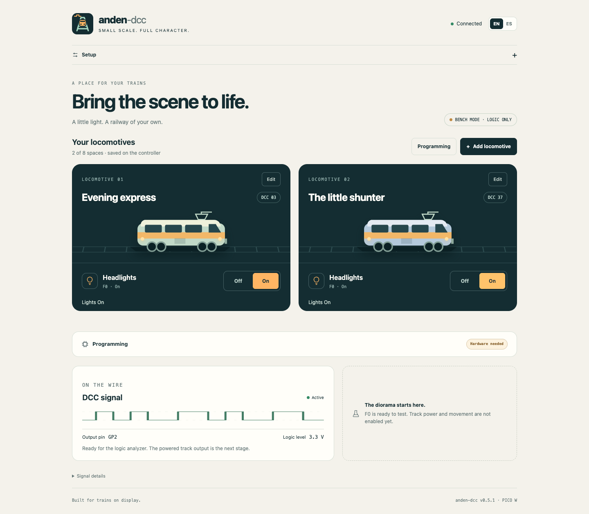
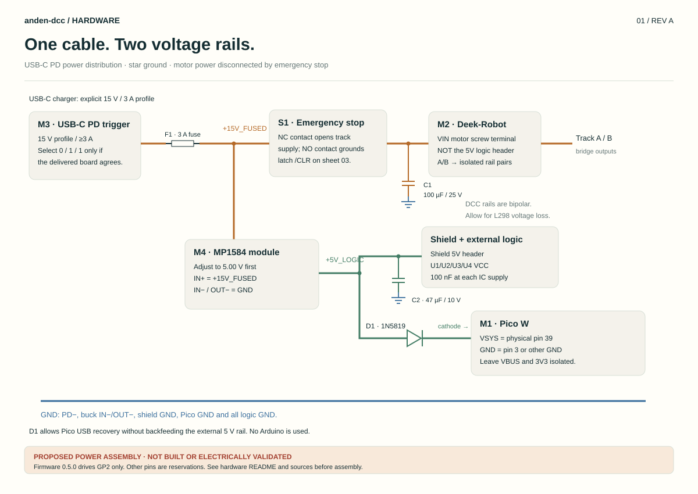

<p align="center"></p>

<p align="center"><strong>Pico W · hardware-timed DCC · Wi-Fi · OTA · English / Español</strong></p>

**anden-dcc** is a small controller for an H0 railway diorama: give your trains
some light, sound and, eventually, a little movement—without a full-size command
station. A Raspberry Pi Pico W hosts the panel and generates DCC in its PIO
hardware, independent of browser and Wi-Fi activity.

**Current release: 0.4.0.** F0/headlights and short addresses are implemented;
the logic waveform is measured. This is a **logic-output prototype**. Track
power, motor control and current protection are not enabled in firmware. The
Deek-Robot power assembly is a documented proposal for the next stage.

[Quick start](#quick-start) · [Hardware & BOM](docs/hardware/README.md) ·
[Signal verification](DCC-ANALYZER.md) · [Release validation](docs/VALIDATION.md) · [API](docs/API.md) ·
[Build](#build-the-firmware) · [Español](README.es.md)



## A place for your trains

- Focused **F0/headlights control**, with short addresses **1–127**.
- **English by default**; an EN/ES switch is remembered by your browser.
- **Setup, closed by default**, contains Wi-Fi and firmware updates.
- Saved 2.4 GHz Wi-Fi settings, reconnection and a setup access point.
- `http://anden-dcc.local`, with direct IP access as fallback.
- OTA updates through the panel; first installation and recovery use USB.
- LED connected/disconnected feedback, with a brief dip on user requests.
  Automatic status polls do not trigger it.
- Self-contained UI: no external fonts, CDN, cloud account or internet required.

The waveform illustration is not a live oscilloscope. Diagnostics show the last
queued packet and nominal timings. Measurements come from an external analyzer.

## Quick start

1. Power the flashed Pico and connect to its open **`anden-dcc`** Wi-Fi.
2. Open **`http://192.168.42.1`**, expand **Setup**, and enter your 2.4 GHz network.
3. Return to your usual Wi-Fi when the Pico's setup network disappears.
4. Open **`http://anden-dcc.local`** or the address assigned by your router.
5. Enter a short DCC address and switch **Headlights / F0** on or off.

Default after boot: **address 3, F0 off**. F0 is not persisted; network settings
are. Changing the address stops refreshing the old one without sending it off.
The function-group packet also sets F1–F4 off.

The network and updater are intentionally open for this local prototype. Your
router password is entered in Setup and stored on the Pico, not in source.

### Logic analyzer hookup

| Analyzer lead | Pico W |
| --- | --- |
| D0 / CH0 | **GP2 — physical pin 4** |
| GND | **GND — physical pin 3** |

Capture at **8 MS/s** for **100 ms**. Connect only to GPIO for this stage;
powered DCC rails require a different measurement interface.

| Address 3 | Packet | Nominal half-bit widths |
| --- | --- | --- |
| F0 off | `03 80 83` | 58 µs for 1, 100 µs for 0 |
| F0 on | `03 90 93` | 58 µs for 1, 100 µs for 0 |

Real Logic 2 captures decoded 14 complete packets per state with no XOR errors.
Half-bits measured 58.000–58.125 µs and 100.000–100.125 µs at 8 MS/s.
[Full signal guide](DCC-ANALYZER.md).

## Hardware & BOM

Chosen hardware: **Pico W + Deek-Robot L298P**, one USB-C PD input, a 15 V trigger
and the existing MP1584 set to 5 V. No Arduino board is required. The protected
power proposal adds level translation, ADC dividers, a power-on-cleared arm
latch and an independent current trip.

The shield's 5 V CD4077 direction logic is why direct Pico-to-shield wiring is
not proposed. The L298 input specification alone does not cover the whole shield.

| Document | Contents |
| --- | --- |
| [Hardware guide](docs/hardware/README.md) | Power, logic levels, stages, pin plan and acceptance checks |
| [BOM](docs/hardware/BOM.md) / [CSV](docs/hardware/bom.csv) | Quantities, existing/ordered parts and additions |
| [Power](docs/hardware/power.svg) | USB-C PD, fuse, buck and VSYS diode |
| [Control](docs/hardware/control.svg) | Pico → buffer → shield and current sensing |
| [Protection](docs/hardware/protection.svg) | Proposed latched trip and emergency stop |
| [Connections](docs/hardware/connections.csv) | Exact nets and component pins |
| [Sources](docs/hardware/sources.md) | Manufacturer and project references |



**Only the Pico/analyzer stage is measured.** The power assembly still needs
bench validation and arm/enable/ADC firmware before connecting trains. The
present function-only firmware does not send motor stop packets.

## Build the firmware

Use Arduino CLI 1.x and the **Earle Philhower Arduino-Pico core 6.3.1**.
Select **Raspberry Pi Pico W**, **1 MB sketch + 1 MB LittleFS**. OTA stages the
image in LittleFS; changing the layout can break updates.

```sh
arduino-cli core update-index --additional-urls https://github.com/earlephilhower/arduino-pico/releases/download/global/package_rp2040_index.json
arduino-cli core install rp2040:rp2040@6.3.1 --additional-urls https://github.com/earlephilhower/arduino-pico/releases/download/global/package_rp2040_index.json
python3 tools/embed_web.py
arduino-cli compile --fqbn rp2040:rp2040:rpipicow:flash=2097152_1048576 --output-dir build firmware/anden-dcc
```

Or run `sh tools/build.sh`. `ARDUINO_CLI` can point to a bundled executable.
First USB install: hold BOOTSEL while connecting, then copy
`build/anden-dcc.ino.uf2` to RPI-RP2, or use picotool.

Next updates: **Setup → Firmware update**, choose **`build/anden-dcc.ino.bin`**.
The server stops GP2 before installing; the panel shows progress and reloads
after restart. **Do not upload UF2 over OTA.**

The CLI helper verifies success and the running version:

```sh
python3 tools/ota.py --host anden-dcc.local --file build/anden-dcc.ino.bin --expect-version 0.4.0
```

Use the Pico IP for `--host` if mDNS is slow. Normal firmware OTA preserves saved
Wi-Fi settings. BOOTSEL remains the recovery path.

## Tests & development

```sh
python3 tools/embed_web.py --check
python3 tests/check_dcc.py
python3 tools/decode_dcc_csv.py path/to/digital.csv --expected '03 80 83'
```

The host check executes the C++ encoder and models **assembled PIO opcodes** for
all 254 address/F0 combinations, pulse lengths, repeated frames and complete
packet updates. The CSV decoder independently checks real analyzer exports.

Browser checks use a mocked controller, never your Wi-Fi settings or trains:

```sh
npm ci --prefix tools/ui-tests
npx --prefix tools/ui-tests playwright install chromium
npm test --prefix tools/ui-tests
```

Set `CHROME_PATH` to an installed Chrome to skip the browser download.
Screenshots go to `build/ui/` or `UI_ARTIFACTS`. Checks cover language, collapsed
Setup, commands, address editing, mobile layout, offline state and failed upload
recovery. GitHub Actions runs host checks, compilation and UI checks when hosted.

Edit `web/index.html` and `web/icon.svg`, then run `tools/embed_web.py`.
Generated `WebAssets.h` is checked in for direct Arduino IDE builds. If PIO
changes, regenerate its header with the core's `pioasm`, then run the timing
checks. `tools/draw_hardware.py` regenerates the SVG wiring sheets.

```text
firmware/anden-dcc/   Pico sketch, packet encoder and PIO generator
web/                 self-contained bilingual UI and app icon
assets/              GitHub banner, icon and UI previews
docs/hardware/       wiring proposal, BOM, connections and sources
tests/               host packet/timing check
tools/               web embedding, OTA, capture decoding and UI checks
```

## Next stops

- [x] Wi-Fi, web control and OTA without a USB connection.
- [x] PIO DCC timing and F0 packets measured on hardware.
- [x] English/Spanish UI with hidden-by-default Setup.
- [ ] Build and validate the protected Deek-Robot power harness.
- [ ] Implement arm/disarm, current sensing and startup stop packets.
- [ ] Add a second refreshed locomotive, sound and restricted movement.

[Changelog](CHANGELOG.md) · [Contributing](CONTRIBUTING.md)
