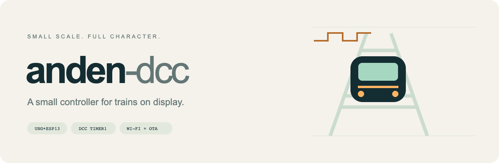
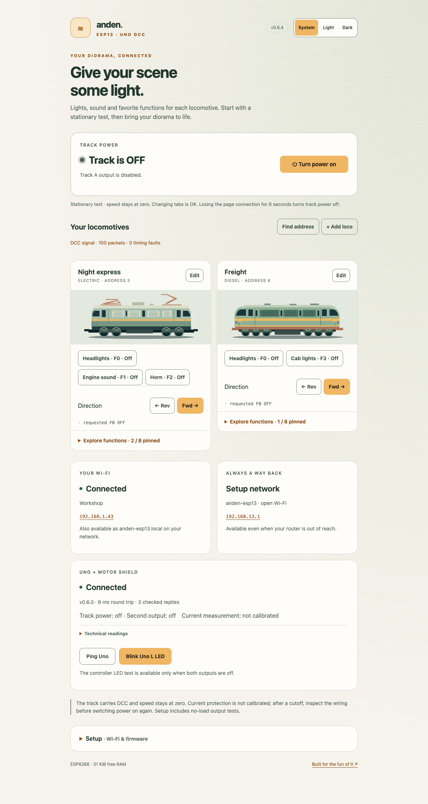

<p align="center"></p>
<p align="center"><strong>Arduino Uno · L298P motor shield · ESP13 Wi-Fi shield</strong></p>

> **The magic-smoke clause**
>
> Use at your own discretion. This is a hobby project, supplied as-is, with no warranty.
> If it liberates the magic smoke from your Uno, motor shield, decoder or favourite
> locomotive, you get to keep all the pieces. The author accepts no responsibility
> for the smoke, the smell, or explaining the new train budget to your family.

---

**anden-dcc** is a small controller for an H0 railway diorama: give your trains
light, sound and character from a web panel. An **Arduino Uno** generates DCC,
a **Deek-Robot L298P motor shield** powers the rails, and a **DOIT ESP13 shield**
hosts Wi-Fi, the panel and firmware updates. These three stacked boards are the
supported build.

**Current firmware: ESP13 0.6.4 / Uno 0.6.0.** Speed stays at zero. This release
controls functions and direction; it does not offer a throttle or CV programming.
[Español](README.es.md) · [Wiring and BOM](docs/hardware/README.md) ·
[API](docs/API.md) · [Validation](docs/VALIDATION.md) · [UI review](docs/UI-REVIEW.md) · [Code structure](docs/CODE-STRUCTURE.md)

## The panel

- Two loco cards to start, up to eight independent short addresses (1–127).
- Electric, diesel and steam artwork, with directional white/red lights.
- F0–F28 single-button toggles, including a permanent F0 button on every loco.
  Expand **Explore functions**, test a function, give it a name and pin it. Up to eight named favorites per loco remain visible when collapsed.
  Functions and direction can be prepared with track power off; switching them
  changes the requested state without enabling the track.
- Explicit track power with a compact control that stays visible after scrolling.
- Guided address discovery: enter a range, watch the lights and answer the questions.
- System / Light / Dark buttons. Wi-Fi and OTA live under the collapsed **Setup** menu.
- Saved loco names, addresses, types and favorite labels, shared across browsers.
- ESP blue LED: blinking while connecting, steady on Wi-Fi, a brief dip on user requests.

Function meanings depend on your decoder. Buttons latch On/Off; horns are not
momentary controls yet. All requested function states start OFF after an ESP
restart. Address changes also reset them; renaming preserves them. Pins/names
survive ordinary ESP OTA with the same flash layout.



## Hardware

| Part | Role |
| --- | --- |
| Arduino Uno R3 / ATmega328P, 16 MHz, 5 V | Timer1 DCC, checked serial commands, output timeout |
| Deek-Robot L298P motor shield, Uno Rev3-style pinout | Bridge A powers the track; bridge B stays disabled |
| DOIT ESP13 / ESP-WROOM-02 Wi-Fi shield | Web UI, Wi-Fi, saved roster, OTA |
| USB power for Uno | Supplies the boards' 5 V logic |
| USB-C PD trigger + compatible charger/cable, verified 15 V output | Separate motor VIN supply |

**Open the motor shield's VIN CONNECT link** before using separate motor power.
Verify VIN terminal → Arduino VIN header is isolated and GND remains connected.
Leave the CD4077 installed; the Uno uses the shield's normal 5 V signals. No added
level shifter is required for this stack. A+ and A− feed both tracks in parallel;
neither rail is ground. See the [wiring guide](docs/hardware/README.md),
[BOM](docs/hardware/BOM.md) and [connection diagram](docs/hardware/schematic.svg).

## Build and first upload

Use Arduino CLI and the tested cores:

```sh
arduino-cli core install arduino:avr@1.8.7
arduino-cli core update-index --additional-urls https://arduino.esp8266.com/stable/package_esp8266com_index.json
arduino-cli core install esp8266:esp8266@3.1.2 --additional-urls https://arduino.esp8266.com/stable/package_esp8266com_index.json
tools/build.sh
```

The build compiles both sketches and runs native checks. For Arduino IDE, open
`firmware/uno-stack-test/uno-stack-test.ino` or
`firmware/esp13-ota/esp13-ota.ino` and install the local `libraries/AndenStackLink`
library. Generated web assets are checked in.

For the Uno upload, disconnect motor VIN and the track, leave USB connected and
turn both ESP13 UART switches OFF:

```sh
arduino-cli upload --fqbn arduino:avr:uno --port UNO_PORT --input-dir build/uno-stack-test
```

The ESP needs one serial installation before OTA is possible. Use a 3.3 V logic
USB-UART adapter with both shield switches OFF; identify and back up its flash
before replacing firmware. The [ESP installation guide](firmware/esp13-ota/README.md)
covers the flash layout and bootloader sequence. After uploading, remove the
adapter, stack the boards and turn both UART switches ON for normal operation.

## Wi-Fi and updates

1. Join the open **anden-esp13** network and open **http://192.168.13.1/**.
2. Expand Setup and save your 2.4 GHz Wi-Fi details.
3. Return to your network and open **http://anden-esp13.local/** or the router IP.
4. Edit the locomotive addresses, or use **Find address** with one loco on the track.
5. Turn power on explicitly, then test headlights, direction and functions.

The setup network remains available for recovery. The panel and OTA intentionally
have no login. Router credentials are stored on the ESP, not in source control.

Turn track power off before an ESP update. Use Setup → firmware, or:

```sh
python3 firmware/esp13-ota/ota.py --host anden-esp13.local \
  --file build/esp13-ota/esp13-ota.ino.bin --expect-version 0.6.4
```

OTA updates **only the ESP**. Uno updates still use USB with both ESP switches OFF
and motor power disconnected. The ESP layout stays **1 MB / 64 KB LittleFS**,
DOUT, for compatibility with the installed application.

## Checks and limits

```sh
npm ci --prefix tools/ui-tests
npx --prefix tools/ui-tests playwright install chromium
npm test --prefix tools/ui-tests
```

CI compiles both boards and exercises packet bytes, UART framing, function masks,
atomic publication, address search, output leases, mouse interaction, themes and
phone layouts. The [logic-analyzer guide](DCC-ANALYZER.md) explains measurements.

Power defaults OFF and requires explicit activation. The Uno has a two-second
control lease; the ESP allows six seconds for browser reconnection. A lost session
does not restart itself. The raw A0 cutoff is **uncalibrated**: short-circuit,
thermal and loaded fault protection are not yet proven. See the
[first-locomotive guide](firmware/uno-stack-test/FIRST-LOCO-TEST.md) for measured
results and remaining limits. Keep motor VIN disconnected during uploads and
firmware diagnostics.

## Repository

```text
firmware/esp13-ota/       ESP web app, Wi-Fi, storage and OTA
firmware/uno-stack-test/  Uno DCC and output control
libraries/AndenStackLink/ Shared packet models and checked UART protocol
web/locos/               Original SVG locomotive artwork
assets/                  GitHub artwork and screenshots
docs/                    API, wiring, BOM and validation
tests/                   Native checks
tools/                   Builds, rendering and browser tests
```

[Changelog](CHANGELOG.md) · [Contributing](CONTRIBUTING.md)

## License

[MIT](LICENSE). Use it, modify it, share it, sell it, build your own tiny railway
empire. Just bring your own replacement smoke.
