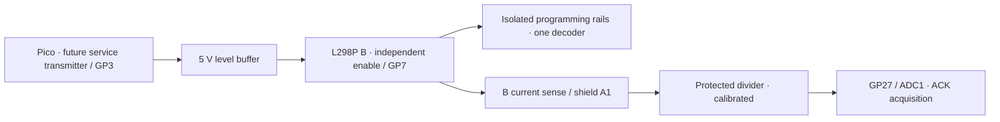

# Decoder programming · preparation and hardware plan

**0.5.1 prepares the UI, API boundary and packet/address helpers. It cannot read
or write a physical decoder yet.** The firmware has no service-mode transmitter,
powered programming output or calibrated ACK input. All programming POSTs return
HTTP 501 for valid requests, without sending packets or changing the roster.
The live GP2 F0 transmitter is unchanged. The deferred analyzer check is still
pending; this release does not claim a fresh physical capture.

## Find an address without knowing it

Use service mode on an electrically isolated output with **one decoder**.
Its identity is not needed to query its CVs. Detect the decoder's basic ACK as
a current increase; a missing reply is an error, never a zero bit or address 3.
Do not factory-reset a decoder merely because its address is forgotten.

The planned read flow is:

1. Establish a current baseline and verify that the decoder acknowledges.
2. Read CV29 to select primary short versus extended addressing.
3. Read CV1 for short mode, or CV17/CV18 for extended mode.
4. Check each bit response and verify the reconstructed byte. Report no ACK,
   ambiguous ACK or invalid address explicitly.
5. Read/report CV19 separately if consist addressing is relevant. A consist
   address and a primary address are different settings.
6. Offer to add/update a roster card only after a successful verified read.
   Extended addresses can be decoded by the host helper; the running F0/roster
   engine still supports **short addresses 1–127 only**.

Changing a roster address currently just points its controls at that address.
It does **not** alter CV1, CV17, CV18 or CV29 in the decoder.

## Give it a known short address

The tested helper builds a CV1 write and a CV29 bit-5 clear. Bit manipulation
preserves the other CV29 settings instead of replacing the byte with a guessed
default. The eventual programmer must verify CV1 and short-address selection
before updating the roster; a write request alone is not proof of success.
Changing CV1 may also clear a decoder's consist address; report that behavior.
Blind writes, address scanning and factory reset are not implemented.

## What the Deek-Robot assembly needs

Proposed use of the existing shield's **B** channel:

This is a signal/block diagram, not a completed wiring design. See the existing
[hardware proposal](hardware/README.md), [BOM](hardware/BOM.md) and
[reserved pins](hardware/connections.csv). No additional Arduino is needed.

- **Isolation:** the programming rails must not be connected to the main rails
  or another controller. Use a separate short track, or a suitable two-pole,
  break-before-make selector for one existing track. Prevent wheels from
  bridging outputs. The selector and final harness are not designed here.
- **Power control:** independent B enable, hardware disarm, startup handling
  and fault reporting still need firmware and physical validation.
- **Programming current limit:** the proposed main-track trip of roughly 1.2 A
  does not provide the programming energy limit. Design and test an appropriate
  programming limit/inrush policy before enabling B. S-9.2.3 specifies a
  250 mA / 100 ms programming condition; this is not a substitute for fast
  short-circuit protection.
- **ACK acquisition:** the shield's current-sense gain and zero/noise must be
  measured on the actual clone. With the proposed nominal divided gain of
  0.825 V/A, a 60 mA change is about 49.5 mV, or roughly 61 ideal 12-bit ADC
  counts at 3.3 V. That calculation is not a calibration or detection threshold.
  Acquisition must keep running during HTTP, align its window to transmitted
  packets, distinguish inrush/noise from ACK, and time out on missing responses.

## Software that exists, and what remains

| Component | 0.5.1 |
| --- | --- |
| English/Spanish Programming panel | Present; hardware-required state; read/write disabled |
| “Don’t know the address?” in the card editor | Opens Programming; return preserves the editor draft |
| API capabilities / valid operation requests | Explicit unavailable / 501; no mutation or transmission |
| Direct byte/bit packet construction, CV1–1024 | Host-tested, including independent known byte vectors |
| Primary short/extended address interpretation | Host-tested; not a live decoder read |
| No-ACK and ambiguous-bit classification | Explicit host helper results, not real sensing |
| Power / timed service transaction / ACK transport | **Not implemented** |
| Decoder reads/writes and roster update from readback | **Not implemented** |
| Legacy register/paged mode | **Not implemented**; relevant for some older decoders |

The existing PIO engine only emits three-byte packets with a 16-one preamble.
Direct-mode service packets need four bytes and a long preamble of at least
20 ones, plus reset/repeat/recovery sequencing. Do not push the helper bytes
into the F0 DMA ring. A separate or generalized transmitter and ACK state
machine must be built and bench-tested before connecting this functionality.

Bench acceptance must include correct long preambles and reset/recovery
sequences, current limiting and isolation, positive/negative/ambiguous ACK
tests, no-decoder timeout, one known decoder's CV reads, verified address writes,
abort/fault handling and disarm on OTA. Every programming result must come from
the physical decoder, not a roster value or simulated ACK.

Run the host checks with `python3 tests/check_programming.py`.

## Primary references

- [NMRA S-9.2.3, July 2012](https://www.nmra.com/sites/default/files/standards/sandrp/DCC/S/S-9.2.3_2012_07.pdf): adopted service-mode packet formats, long preamble, ACK and programming environment. Later drafts are not silently treated as adopted standards.
- [NMRA S-9.2.2](https://www.nmra.com/sites/default/files/standards/sandrp/DCC/S/s-9.2.2_decoder_cvs_2012.07.pdf): CV assignments.
- [TCS CV17 documentation](https://docs.tcsdcc.com/wiki/CV_17): extended address interpretation and CV29 bit 5.
- [DCC-EX ACK diagnostics](https://dcc-ex.com/reference/tools/diagnostic-d-ack-command.html): baseline, bit verification, byte verification and timeout diagnostics.
