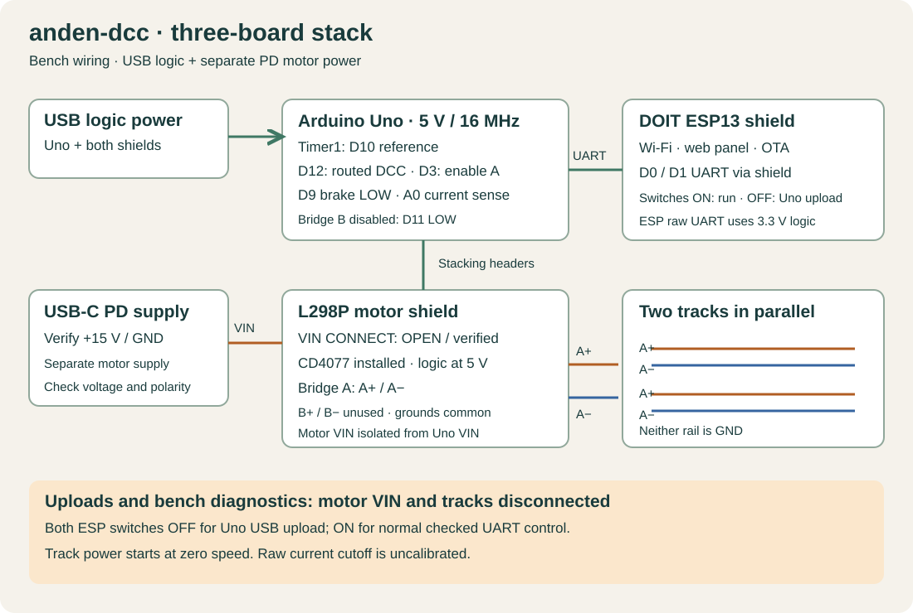

# Uno + motor shield + ESP13 wiring

The supported assembly uses the three boards' normal Uno headers:
**Uno R3 / ATmega328P 16 MHz, Deek-Robot L298P motor shield and DOIT ESP13**.
The motor shield must use the Rev3-style pinout below. Check clone markings.

## Power

- Uno USB powers the Uno and both shields' 5 V logic.
- A compatible USB-C PD charger/trigger supplies **verified 15 V DC** to the motor
  shield VIN/GND screw terminals. Measure voltage and polarity before connection.
- **Open VIN CONNECT on the motor shield.** With all power removed, verify its
  VIN screw terminal is isolated from the Uno VIN header; GND remains common.
- Leave CD4077 installed. Keep the shield's logic at 5 V; no external shifter is
  needed with the Uno's 5 V outputs.
- Feed A+ and A− to the two tracks in parallel. Neither rail is GND. Leave B+/B−
  unconnected. Both locos share the signal and respond to their decoder addresses.

The documented setup uses separate USB logic power and PD motor power. Do not
feed motor VIN into the Uno's 5 V pin or use its onboard regulator for this stack.
A one-cable power supply is not part of this validated connection plan.

## Header signals

| Uno pin | Connected function |
| --- | --- |
| D0 / RX | ESP13 UART through shield switches/level interface |
| D1 / TX | ESP13 UART through shield switches/level interface |
| D3 | Motor enable A |
| D12 | Motor direction A / routed DCC |
| D9 | Brake A, held LOW |
| A0 | Motor shield current-sense A, raw uncalibrated ADC |
| D11 | Motor enable B, held LOW |
| D13 | Motor direction B / Uno L LED; blink only with outputs off |
| D8 | Brake B, held LOW |
| A1 | Current-sense B, telemetry only |
| D10 | DCC hardware reference for analyzer; not a rail connection |

## Upload and first test

Disconnect motor power and track before either serial upload. Both ESP13 blue
switches OFF isolate its UART for Uno USB upload; ON connects Uno ↔ ESP for
normal use. Do not connect a separate USB-UART transmitter while the stack UART
is enabled. A raw ESP UART adapter must use **3.3 V logic**, not Uno logic levels.

First verify USB-only Uno ping and LED, then use the
[power test](../../firmware/uno-stack-test/POWER-TEST.md),
[DCC scope guide](../../firmware/uno-stack-test/DCC-SCOPE.md) and
[first-locomotive guide](../../firmware/uno-stack-test/FIRST-LOCO-TEST.md).
The output timeout and uncalibrated current cutoff do not replace loaded fault
and thermal validation.

[BOM](BOM.md) · [CSV BOM](bom.csv) · [Connections](connections.csv) ·
[Print diagram](print.html)
