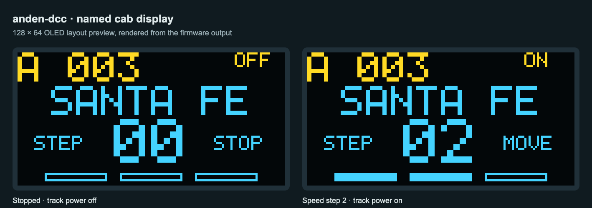
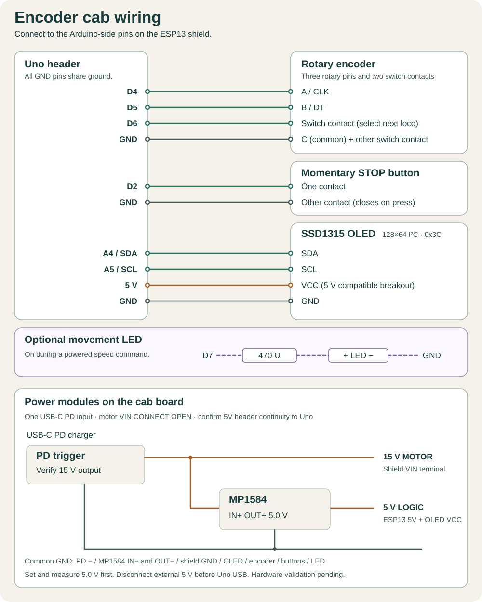

# Encoder cab

Uno 0.7.5 and ESP13 0.7.2 provide local crawl control for one locomotive at a time.
Update the ESP13 first so it understands the new Uno capability. Use the web
panel to mark locos, set direction and turn track power on. Keep that
page's power session alive while using the knob. Motion commands run on the Uno.

Preview rendered from the firmware's display output.

## Cab board and power

The cab board carries the USB-C PD trigger, MP1584 step-down module, encoder,
STOP button, movement LED and OLED. One USB-C PD charger supplies the assembly.
The trigger requests **15 V**. Its output splits between the motor shield VIN
and the MP1584 input. The MP1584 supplies **regulated 5.0 V** to the stack and OLED.

| Source on cab board | Destination |
| --- | --- |
| PD trigger positive, verified 15 V | Motor shield VIN terminal and MP1584 IN+ |
| PD trigger negative | Motor shield GND terminal and MP1584 IN− |
| MP1584 OUT+, verified 5.0 V | ESP13 shield Arduino-side 5V header and OLED VCC |
| MP1584 OUT− | ESP13 shield Arduino-side GND header and cab ground |

All grounds are common, including the encoder and button returns. Use separate,
clearly labelled **15 V MOTOR** and **5 V LOGIC** connectors to the stack.
The track rails connect only to bridge A outputs, A+ and A−.

Keep the motor shield's **VIN CONNECT open** and verify that its VIN terminal
is isolated from the Uno VIN header. With the stack unpowered, also confirm
continuity from the chosen ESP13 5V/GND pins to the matching Uno header pins.
Feeding 5 V here bypasses the Uno's regulator.

Before connecting the stack or OLED, power the PD trigger and MP1584 alone.
Measure the PD output and adjust the MP1584 to **5.0 V**, checking polarity.
Unplug the charger before completing the wiring. Check that the 5 V rail stays
stable when the ESP connects to Wi-Fi. This cab supply arrangement still needs
physical validation; the earlier bench checks used Uno USB and separate motor power.

For a Uno USB upload, unplug the cab's PD charger and disconnect its **5 V LOGIC**
feed and the track before connecting Uno USB. Both ESP13 UART switches must be
OFF for the upload. Disconnect Uno USB before reconnecting the cab power feeds.
This prevents the external 5 V rail and Mac USB supply from feeding each other.

## Connections

Disconnect all power and the track before wiring. Use the **Uno** pins
on the shield headers. Follow the power isolation steps above for USB uploads.

The [base stack schematic](../../docs/hardware/schematic.svg) shows the original USB-powered bench arrangement and the bridge A track connections.

| Part | Signal | Uno |
| --- | --- | --- |
| Mechanical encoder | A / CLK | D4 |
| Mechanical encoder | B / DT | D5 |
| Encoder button | SW (select next loco) | D6 |
| Momentary STOP button | Contact to GND when pressed | D2 |
| Encoder contacts | Common and button return | GND |
| SSD1315 OLED | SDA | A4 / SDA |
| SSD1315 OLED | SCL | A5 / SCL |
| SSD1315 OLED | GND | GND |
| SSD1315 OLED | VCC | Uno 5 V, with a 5 V compatible breakout |
| Optional movement LED | Anode (+) through a 470 Ω resistor | D7 |
| Optional movement LED | Cathode (−) | GND |

The encoder and STOP inputs have pull-ups and expect contacts that close to ground. Use
the pin labels on your module. Swap A and B if clockwise decreases speed. The
decoder counts four valid quadrature transitions per step.

Use a 0.96-inch 128×64 I²C SSD1315 Arduino-compatible breakout at address
`0x3C`, with 5 V compatible power and I²C inputs and onboard reset circuitry.
Follow the module's printed pin labels. The cab's MP1584 supplies its VCC at 5.0 V.

The display is probed at Uno boot. The yellow header shows the selected address
and track power status. The blue area shows the loco name saved in the web
panel, a large two-digit speed step, STOP/MOVE status and a three-segment speed
bar. An unnamed loco shows LOCOMOTIVE; with no eligible loco, SELECT A LOCO appears.

The ESP sends display labels when synchronizing the roster. The Uno caches all
eight eligible labels, so the encoder button changes the name immediately.
Labels use the first 16 characters in uppercase, folding Latin-1 accents;
unsupported characters become a question mark. Full UTF-8 names remain saved
unchanged in the web panel. Name metadata never enables track output.

Rendering uses short, polled I²C writes without a full framebuffer to preserve
Uno RAM and keep servicing the controls. The OLED transport leaves TWI
interrupts disabled so Timer1 can preempt display transfers. A stalled transfer
times out and disables further display writes while the cab continues running. The cab also runs with the display disconnected.

SSD1315 Arduino modules can use the SSD1306 128×64 command configuration.
Static output on the actual module was confirmed on 12 November 2026 with
USB logic power: `A 003` in yellow and `S 00` in blue.
[SSD1315 Arduino example](https://wiki.seeedstudio.com/Grove-OLED-Yellow%26Blue-Display-0.96-SSD1315_V1.0/)

## Operation

1. With power off, open **Edit** on each loco that is physically on the diorama.
   Check **On diorama** and save. Existing rosters start with all cards unchecked.
   Set direction in the panel, then turn track power on.
2. Turn clockwise to increase the selected loco's speed and counterclockwise
   to reduce it. The initial cap is three DCC crawl steps. All other loco
   addresses keep their zero-speed refresh.
3. Press the encoder button once to select the next marked loco. If the current
   loco is moving, the Uno sends it a stop first. Selection wraps around the
   marked list and the next loco starts at step zero.
4. Press the separate **STOP** button to broadcast an emergency stop to all
   addresses on the powered track. Selection stays put and the track stays
   powered for lights and sound. Release STOP and turn the encoder again to move.

The movement LED is steady while track power is on and the Uno commands a
nonzero speed. It goes dark when the commanded speed returns to zero or track
power is cut. It indicates the speed command, so the locomotive can still coast
after the LED goes dark.

An 800 ms motion limit starts with the first nonzero step. Turning the knob or
receiving a web heartbeat cannot extend it. A fresh turn starts another move.
Roster, direction or function updates stop motion before applying the new
schedule. Track power loss clears the speed, and the finder suspends the cab.
If the main loop stalls while Timer1 continues, a separate interrupt counter
cuts bridge A after 16,000 half-bits, nominally 0.928–1.6 seconds. Use **Turn
power off** in the panel to disable the whole track output.

## First check

Start USB-only with motor VIN and track disconnected. Check the displayed
address and speed and use D10/D12 to verify the prioritized speed and stop
packets. Then test one locomotive on a test track and measure its actual
stopping distance at step 1 in both directions before using the diorama.
The display reports the commanded step. Decoder settings, drivetrain and load
determine travel and stopping distance. OLED updates during motion and powered movement still require
physical validation.
