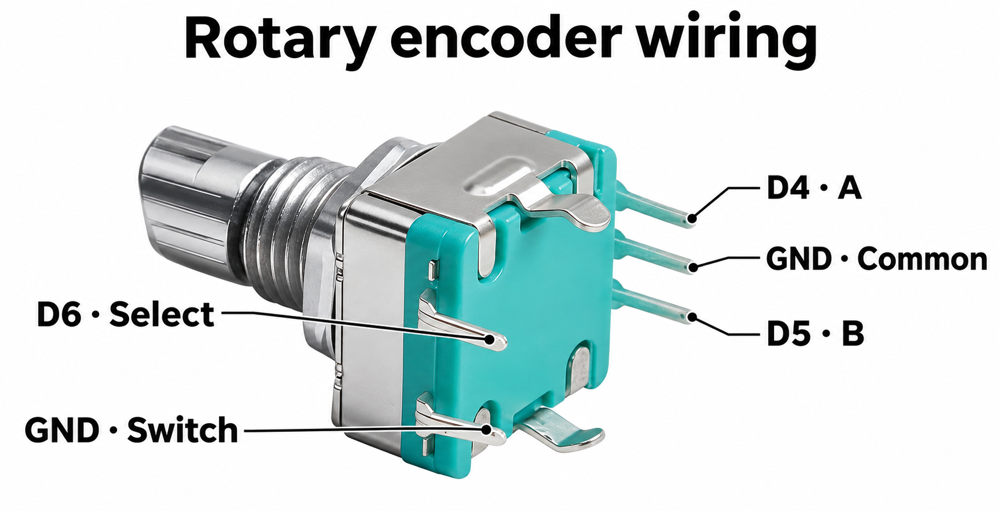

# Encoder cab

Uno and ESP13 0.7.1 provide local crawl control for one locomotive at a time.
Update the ESP13 first so it understands the new Uno capability. Use the web
panel to mark locos, set direction and turn track power on. Keep that
page's power session alive while using the knob. Motion commands run on the Uno.

## Connections

Disconnect motor VIN and track before wiring or uploading. Use the **Uno** pins
on the shield headers.

| Part | Signal | Uno |
| --- | --- | --- |
| Mechanical encoder | A / CLK | D4 |
| Mechanical encoder | B / DT | D5 |
| Encoder button | SW (select next loco) | D6 |
| Momentary STOP button | Contact to GND when pressed | D2 |
| Encoder contacts | Common and button return | GND |
| SSD1306 OLED | SDA | A4 / SDA |
| SSD1306 OLED | SCL | A5 / SCL |
| SSD1306 OLED | GND | GND |
| SSD1306 OLED | VCC | Uno 5 V, with a 5 V compatible breakout |

The encoder and STOP inputs have pull-ups and expect contacts that close to ground. Use
the pin labels on your module. Swap A and B if clockwise decreases speed. The
decoder counts four valid quadrature transitions per step.

Use a 128×32 I²C SSD1306 breakout at address `0x3C` with 5 V compatible power
and I²C inputs and onboard reset circuitry. A bare SSD1306 uses 3.3 V logic.
The display is probed at Uno boot. It shows `A 003` for address 3 and `S 01` for
commanded step 1. The cab can run with the display disconnected.
[5 V compatible 128×32 breakout](https://www.adafruit.com/product/4440)

## Operation

1. With power off, open **Edit** on each loco that is physically on the diorama.
   Check **On diorama** and save. Existing rosters start with all cards unchecked.
   Set direction in the panel, then turn track power on.
2. Turn clockwise to increase the selected loco's speed and counterclockwise
   to reduce it. The initial cap is three DCC crawl steps. All other loco
   addresses keep their zero-speed refresh.
3. Press the encoder button once to select the next marked loco. If the current
   loco is moving, the Uno sends it a stop first. Selection wraps around the
   marked list and the next loco starts at step zero.
4. Press the separate **STOP** button to broadcast an emergency stop to all
   addresses on the powered track. Selection stays put and the track stays
   powered for lights and sound. Release STOP and turn the encoder again to move.

An 800 ms motion limit starts with the first nonzero step. Turning the knob or
receiving a web heartbeat cannot extend it. A fresh turn starts another move.
Roster, direction or function updates stop motion before applying the new
schedule. Track power loss clears the speed, and the finder suspends the cab.
If the main loop stalls while Timer1 continues, a separate interrupt counter
cuts bridge A after 16,000 half-bits, nominally 0.928–1.6 seconds. Use **Turn
power off** in the panel to disable the whole track output.

## First check

Start USB-only with motor VIN and track disconnected. Check the displayed
address and speed and use D10/D12 to verify the prioritized speed and stop
packets. Then test one locomotive on a test track and measure its actual
stopping distance at step 1 in both directions before using the diorama.
The display reports the commanded step. Decoder settings, drivetrain and load
determine travel and stopping distance. The OLED and powered motion require
physical validation.
