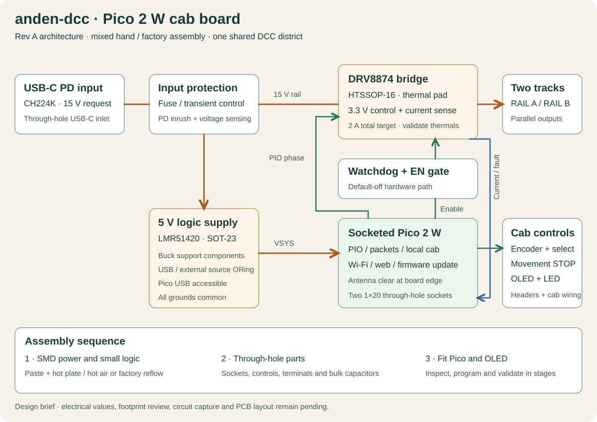

# EXPERIMENT · Pico 2 W cab board · Rev A

The [project record](PROJECT.md) keeps the requirements, decisions, alternatives,
prototype evidence and open work together. Update it whenever an important
design choice or hardware result changes.

This experiment explores a self-contained Pico 2 W cab PCB.

**Status is EXPERIMENTAL / DESIGN ONLY.** The supported anden-dcc platform is
the Uno + L298P motor shield + ESP13 stack. This design remains a separate
hardware investigation. It integrates USB-C PD, the track power stage and the cab around a
socketed Pico 2 W. The Pico and existing OLED are the retained assemblies.
The PD, regulator, driver and protection circuits use individual components.

Status is component and assembly planning. The BOM is preliminary. Electrical
schematic, footprints, PCB dimensions and routing still require completion and
review before fabrication.

## Requirements and initial design targets

- Pico 2 W on two 1×20, 2.54 mm through-hole sockets.
- One DCC channel feeding the two diorama tracks in parallel.
- USB-C PD input requesting 15 V, with a compatible 15 V / 3 A source.
- Provisional 2 A track design target, subject to load and thermal tests.
- Encoder rotation for speed, encoder press for selected loco, and a separate
  STOP button that commands emergency stop while preserving lighting.
- Existing 128×64 yellow/blue I²C OLED and a movement LED.
- Local cab operation, a web interface and a recoverable firmware update path.
- Components suitable for hand assembly and factory assembly on the same PCB.

The 2 A target is the combined total for both track connectors and is a design assumption. The final current limit must account for
both locomotive loads, driver dissipation, connectors and charger capacity.

## Package choices

| Function | Candidate | Package and assembly |
| --- | --- | --- |
| Controller | Raspberry Pi Pico 2 W | Header-mounted module, installed after reflow |
| PD negotiation | CH224K | ESSOP-10, visible leads and underside ground pad |
| Logic regulator | LMR51420XDDCR, 5 V output | Leaded SOT-23-THIN-6 |
| DCC bridge | DRV8874PWPR | HTSSOP-16 with an exposed thermal pad |
| External watchdog | TPS3435 family | Leaded SOT-23-THIN-8 variant, order code pending |
| Enable gate | SN74LVC1G08DBVR | Leaded SOT-23-5 |
| USB-C inlet | GCT USB4750-GF-C candidate | Six-contact through-hole, vertical entry |
| OLED interface | Existing SSD1315 board | Keyed cable/header, mounting holes to be measured |
| Cab mechanics | Existing encoder, STOP and LED | Through-hole or panel-mounted |
| General passives | Axial resistors, radial capacitors | Through-hole where placement permits |
| Local bypass and switching passives | Ceramic capacitors, shielded inductor | 0805/1206 capacitors and a large-pad SMD inductor |

The CH224K and DRV8874 underside pads require solder paste and reflow heat.
Their visible leads can be inspected or reworked with an iron. The remaining
small ICs have visible leads. A hot plate or hot-air tool is part of the hand
assembly method for the power section.

The DRV8874 accepts 3.3 V logic and includes current sensing and regulation.
Its 6 A peak device rating is separate from the finished PCB's continuous
current capability. The thermal pad, copper and vias must be designed together.
[TI DRV8874 datasheet](https://www.ti.com/lit/ds/symlink/drv8874.pdf)

The LMR51420 accepts 4.5–36 V input. Its 5 V rail supplies Pico VSYS through
source isolation. The inductor, feedback divider and effective ceramic
capacitance must be checked for the actual input range and load.
[TI regulator datasheet](https://www.ti.com/lit/ds/symlink/lmr51420.pdf)

CH224K requests the PD profile with hardware configuration. The exact strap
resistor and VBUS/VDD support network must be taken from the current WCH
datasheet before the schematic is frozen. Its PG output is interpreted
together with a measured rail voltage.
[WCH CH224 documentation](https://www.wch-ic.com/downloads/CH224DS1_PDF.html)

The watchdog candidate has a leaded package, but its full order code determines
timeout, output and enable behavior. Those choices remain open. Its healthy
output and the Pico track-enable request feed the hardware enable gate.
[TI TPS3435 documentation](https://www.ti.com/product/TPS3435)

The USB4750 candidate provides six through-hole contacts and is rated for 3 A.
Its vertical entry must fit the enclosure before selecting the footprint.
[Connector drawing and specifications](https://gct.co/connector/usb4750)

## Power and signal design

The intended path is USB-C to input protection, then separate branches for
the bridge supply and 5 V regulator. Size and switch the bridge bulk capacitance
so USB-C attachment and PD negotiation satisfy input inrush limits.

Pico programming USB and the external 5 V regulator need an ORing/isolation
circuit feeding VSYS. Measure and verify reverse-current behavior in both
directions. The Pico USB connector remains accessible for recovery.

The cab inputs use 3.3 V pull-ups. The H-bridge control inputs use 3.3 V logic.
Check the actual OLED supply and pull-ups before connecting it. Its connector
must have a defined pin order. A level translator is populated only if that
display needs a 5 V bus.

Sense the bridge current through IPROPI and measure the input rail through a
divider. Both ADC paths require filtering and overvoltage analysis, including
driver faults and USB-PD startup. The current-limit reference and sense resistor
values remain to be calculated.

The bridge starts disabled through hardware pull-downs. Firmware must verify
the rail and driver state before enabling output. Configure the proposed bridge
for PH/EN control with PMODE strapped LOW. Wake it, wait for the specified wake
time, then enable at a DCC packet boundary.

The external watchdog gates bridge EN independently of the MCU's output pin.
Feed it only when application checks and DCC packet progress are healthy.
A timeout must leave output disabled until an explicit recovery sequence.
Watchdog timeout, latch/re-arm behavior and startup sequencing need verification
in the detailed circuit.

The movement STOP button remains a direct local MCU input for broadcast DCC
emergency stop. A watchdog or driver fault disables the power stage.

PIO produces the DCC edges while software supplies complete packets through a
buffered path. Define FIFO-underrun behavior and watchdog recovery before
connecting a locomotive. Software resource allocation must also account for
the Pico 2 W wireless driver.

## Assembly rules

Use one SMD population side, standard manufacturer land patterns and consistent
orientation marks. Provide iron access at exposed lead toes and roughly 2 mm
rework space around IC bodies where the electrical layout permits it.
Keep bypass capacitors and switching loops compact.

Prefer 1206 for configuration resistors and suitable capacitors. Use 0805
where local decoupling needs it. General cab resistors and bulk capacitors
can be through-hole. Avoid competing SMD and through-hole population options
on the same nets in the production BOM.

Use a two-layer, 1.6 mm FR-4 board as the initial fabrication target. Copper
weight and power-plane dimensions remain dependent on current and thermal
calculations. Maintain a continuous logic ground return while routing track
current loops away from the controller and cab inputs.

Place the Pico antenna at a board edge with the manufacturer's keep-out
clear of copper, components, fasteners and enclosure metal. Keep its USB and
BOOTSEL accessible, and provide SWD access.
[Pico 2 W datasheet](https://datasheets.raspberrypi.com/picow/pico-2-w-datasheet.pdf)

Mark connector functions, pin 1, polarity and measured rail names on silkscreen.
Label track terminals RAIL A and RAIL B. Both rails are bridge outputs. Provide test points for GND, PD VBUS,
5 V, 3.3 V, DCC PH, guarded EN, FAULT, rail sense and current sense.

For hand assembly, populate and inspect the SMD power section with paste and
reflow heat first. Add through-hole parts and socketed assemblies afterward.

For factory assembly, provide a single populated BOM with exact MPNs and
reference designators, top-side centroid data, fabrication files, stencil data,
assembly drawings, and programming/test instructions. Quote SMD population and
through-hole completion separately so either assembly route can use the board.

## Outstanding decisions before schematic and PCB release

1. Calculate driver current limit, bulk capacitance, input inrush and thermal
   copper requirements against the provisional 2 A design target.
2. Select protection, source-isolation and watchdog order codes and prove
   startup, PD fallback, timeout and re-arm behavior.
3. Confirm the encoder, button, OLED mounting dimensions and enclosure
   connector orientation. The initial GPIO allocation is in [pinmap.csv](pinmap.csv).
4. Verify each candidate symbol and footprint against its exact package drawing,
   especially the exposed pads and USB-C connector.
5. Complete the electrical schematic and PCB, run ERC/DRC, and review all
   manufacturing outputs before ordering.
6. Bring up logic and PD first, then test unloaded DCC, current cutoff, shorts,
   heating and stopping distance with appropriate loads.

[Preliminary BOM](bom.csv)

## Native KiCad project

Open [the KiCad project](kicad/anden-dcc-pico2w-reva.kicad_pro). See the
[CAD status and sheet map](kicad/README.md) before editing. This is an
experimental project with the [PD core captured for review](kicad/review/01a-usb-pd.md).
Remaining circuit capture and PCB layout are pending.
