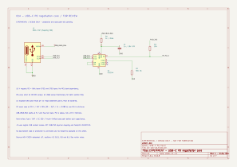

# EXPERIMENT · review 01A · USB-C PD negotiation

**EXPERIMENTAL / DESIGN ONLY — awaiting user schematic review.**

This is the first review block within sheet 01. Input protection and the
high-current load path are still pending. The other five sheets remain planning
notes. The user owns PCB placement/routing; the assistant captures schematics
and reviews the user's PCB work. Do not alter board layout as part of schematic
capture unless requested.

U1 is a **WCH CH224K**, ESSOP-10 with exposed ground pad. The drawing shows
only its reference and part name; manufacturer/package details stay in these
notes, and the datasheet link is a hidden property.

## Captured circuit

| Reference | Proposed value | Purpose |
| --- | --- | --- |
| J3 | Logical USB-C power-only 6P receptacle | CC1/CC2 and raw VBUS; shield tied to circuit GND |
| U1 | CH224K | Autonomous PD negotiation |
| R1 | 1 kΩ, at least 0.5 W | VBUS feed to the IC's internal VDD shunt regulator |
| C1 | 1 µF, 10 V X7R | Local VDD bypass, select effective capacitance at 3.3 V |
| R2 | 56 kΩ, 1% | CFG1 to GND requests 15 V |
| R3 | 10 kΩ | PG pull-up to the eventual Pico 3.3 V rail |

R1's conservative dissipation estimate at 20 V raw input and 3.0 V VDD is
`(20 - 3)^2 / 1000 = 0.289 W`. At 15 V / 3.3 V it is about 0.137 W.
The final resistor must retain adequate rated power at the enclosure's design
ambient temperature. The 0.5 W value is a proposed minimum, not a measured
thermal qualification.

CC1 and CC2 go to their corresponding U1 pins. DP/DM are shorted locally
for PD-only operation. VBUS sense pin 8 is deliberately unconnected in that
mode. CFG2 and CFG3 are deliberately open for resistor configuration.
U1's exposed ground pad uses pin **11** in KiCad and **0** in WCH's drawing.
The selected footprint must preserve that mapping and provide a solderable pad.
These connections follow WCH's CH224 datasheet v1F, sections 4.3, 5.2.1, 5.5
and 6.1. The later v2.1 document also confirms the CH224K pin assignment,
1 kΩ supply feed and internal shunt regulator. CH224A/Q are different variants;
do not substitute their supply circuit or voltage-selection table.

## Boundaries and pending work

- Net labels on this sheet are **local**. Inter-sheet ports will be added with
  the protection/load-path circuit and the downstream sheets.
- `USB_VBUS_RAW` is the connector voltage. It initially starts at 5 V and must
  not be treated as a guaranteed 15 V rail. This block does not establish the
  source's available current or enforce the proposed 2 A track budget.
- `PD_PG_N` is an open-drain status signal. A 15 V voltage qualification and
  the downstream enable policy still need explicit design.
- `PICO_3V3` has no source yet. R3 does not use U1 VDD to power or pull up a Pico pin.
- The GCT USB4750-GF-C is still the mechanical candidate. J3 presently uses
  standard USB contact names, **not a verified GCT physical pad mapping**.
  The GCT drawing download returned HTTP 403 during this review; assigning its
  footprint requires obtaining and checking that drawing.
- No footprints or exact purchasing MPNs are assigned in this block.
- Fuse selection, CC protection, overvoltage handling, controlled inrush,
  reverse-current behavior and bulk capacitance belong to review **01B**.
  No load should be connected on the strength of this partial drawing.

## Checks · 12 November 2026

KiCad 10.0.8 parses the full schematic hierarchy and exports all seven pages.
ERC reports **0 errors / 1 warning**: the local `PICO_3V3` label presently has
only R3 attached. This is retained until the logic supply interface exists;
no ERC exclusions were introduced. Power flags identify the external VBUS,
its return and the supply node behind R1, as required for passive power feeds.
They do not prove a supply is present or electrically safe.

The exported XML netlist was checked against the following intended groups:

| Net | Nodes |
| --- | --- |
| USB_CC1 | J3 A5, U1 7 |
| USB_CC2 | J3 B5, U1 6 |
| USB_VBUS_RAW | J3 A9/B9, R1 1 |
| U1 VDD | R1 2, C1 1, U1 1 |
| GND | J3 A12/B12/SH, C1 2, R2 2, U1 11 |
| CFG1 | U1 9, R2 1 |
| PD-only short | U1 4 and 5 |
| PD_PG_N | U1 10, R3 2 |

The SVG was rendered and visually checked. No hardware measurements have been
made on this custom circuit. PCB geometry remains unchanged.

## Review references

- [WCH manufacturer datasheet page](https://www.wch-ic.com/downloads/CH224DS1_PDF.html)
- [WCH datasheet v1F English copy](https://www.laskakit.cz/user/related_files/ch224ds1.pdf)
- [WCH datasheet v2.1 copy hosted by LCSC](https://datasheet.lcsc.com/datasheet/pdf/4f12eebccb4eda2c0038806df0155265.pdf?productCode=C970725)
- [GCT USB4750 manufacturer page](https://gct.co/connector/usb4750)

Review status: **not reviewed by the user yet**. After reviewing 01A, complete
01B on the same sheet before treating the USB-C input section as complete.
