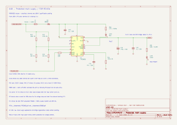
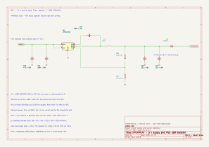

# EXPERIMENT · power schematic review · 01B and 02

**EXPERIMENTAL / DESIGN ONLY — proposed circuit awaiting user review.**

The assistant captures the schematic; the user reviews it and owns PCB layout.
No PCB placement, routing or outline was changed. All footprint fields remain
unassigned until the electrical and mechanical review is complete. No hardware
measurements have been made on these circuits.

## Power flow

`USB-C → raw PD voltage → F1 → D2 → U7 eFuse → VMAIN`

VMAIN splits into the future DCC bridge and `U2 buck → D3 → Pico VSYS`.
Pico's on-board USB diode completes the two-source OR. Programming USB powers
the Pico while the PD supply is absent; it does not power VMAIN. The existing
raw PD circuit operates upstream of F1. Consequently F1 protects the load branch,
not the connector, CC pins or CH224K branch.

## 01B · main input branch

U7 is proposed as **TPS26631PWPR**, a leaded HTSSOP-20 with an exposed thermal
pad. This is a new candidate for review, not a previously accepted part.
D2 is a through-hole SB560, chosen for simple reverse-current isolation; an
external blocking MOSFET is not fitted. Its forward loss is a real tradeoff.
Both U7 IN and IN_SYS connect after D2. Pins 4/5 are deliberately unused.
U7 pad 21 is the thermal pad and shares GND with pin 9.

| Circuit | Proposed parts | Intended result |
| --- | --- | --- |
| Backup fuse | F1: time-delay 3.15 A, DC rating at least 60 V | Load-branch backup; exact fuse/holder and breaking capacity pending |
| Input diode | D2: SB560 | Blocks bulk/rail energy returning to the USB supply |
| Input bypass | C10: 1 µF, 50 V X7R | Local bypass; keep un-switched USB capacitance small |
| Undervoltage divider | R10 100 kΩ / R11 10 kΩ, both 1% | Nominal 13.20 V turn-on, measured **before D2** |
| Overvoltage divider | R12 132 kΩ / R13 10 kΩ, both 1% | Nominal 17.04 V cutoff, also before D2 |
| Current setting | R14 7.15 kΩ, 1% | Nominal sustained limit about 2.52 A |
| Slew setting | C11 47 nF, 25 V | Nominal output ramp about 14.2 ms at 14.5 V input |
| Reservoir | C12 470 µF / 35 V, C13 1 µF / 50 V | Bulk capacitance behind the controlled switch |
| Enable bias | R15 10 kΩ from CH224K VDD | Starts independently of Pico software |

The voltage dividers sense the raw connector rail so D2's varying forward drop
does not shift the voltage qualification thresholds. Using 1% resistor extremes
and the comparator threshold range gives the following calculated bounds,
excluding leakage and temperature coefficient contributions:

- UVLO rising: **12.70–13.71 V**. The ordinary 5/9/12 V fallback profiles are
  rejected under an assumed ±5% source tolerance; a 15 V profile can start.
- OVP rising: **16.39–17.71 V**. A normal 15 V profile fits below the band; a
  20 V profile is outside it. This is not a surge clamp or a guarantee of zero
  transient overshoot.

For C11, `20.8e3 × 14.5 × 47e-9 ≈ 14.2 ms`. Charging about 476 µF behind
U7 contributes roughly 0.49 A during that ramp, before load current. Capacitor
tolerance, buck startup and the future driver capacitance need to be added to
the final inrush/SOA check.

MODE is intentionally open for **latch-off** after sustained overload. Recovery
requires cycling the PD supply, or an intentionally designed future re-arm path.
The selected variant permits an initial overload pulse near twice its sustained
setting. A 2.52 A setting therefore **does not enforce a hard 3 A USB contract**.
Source capability, pulse response and fuse coordination require review. The fuse
is not the fast DCC short-circuit mechanism; driver current limiting and hardware
bridge shutdown are separate work.

PGTH is grounded; PGOOD and IMON are unused. FLT now drives the red fault LED. CH224K VDD
feeds only U7's enable through R15, not the Pico. The future bridge should stay
disabled until valid power and healthy DCC have been established.

## Power indicator LEDs

Two through-hole, high-efficiency 3 mm LEDs have been added. LED1 remains the
separate movement indicator reserved for the cab. Exact LED MPNs and lead
spacing remain pending.

| Indicator | Wiring | Meaning |
| --- | --- | --- |
| LED2 red, FAULT | U7 input after D2 → R30 4.7 kΩ / 0.25 W → LED anode; cathode → U7 FLT pin 15 | Lights when U7 asserts a fault and its input supply is present |
| LED3 green, MAIN POWER | VMAIN → R31 6.8 kΩ / 0.25 W → LED anode; cathode → GND | Protected main rail voltage is present |

The red branch is upstream of the controlled switch, so cutting VMAIN does not
remove its power. It uses U7's open-drain fault output directly, without a Pico
GPIO or transistor. It is not fed from CH224K VDD: that small bias rail remains
reserved for enable/status circuitry. Both LED branches use direct wires and add
no internal net labels.

For a preliminary red LED forward-voltage range of 1.6–2.2 V, the red current
is roughly 0.5–0.65 mA at a 4.7 V input and about 2.5–2.7 mA at 14.5 V,
including the fault output's specified pull-down resistance. With a 20 V upper
review input and a 5% resistor allowance, even an LED short keeps sink current
below about 4.5 mA. This is below FLT's 10 mA absolute maximum. The resistor's
conservative dissipation bound is about 0.09 W, so 0.25 W is proposed. Raw-input
surge protection must still be coordinated with this branch; these calculations
do not qualify the indicator for an arbitrary 60 V input just because U7 can
operate there.

Green current is about `(14.5 - 2.2) / 6800 = 1.8 mA`, with about 0.022 W in
R31. The future selected LED's brightness and forward voltage must be checked
at these low currents. The exact LED datasheets will be stored locally when
MPNs are chosen.

Green is deliberately a **voltage-present** indication, not PGOOD, DCC enabled,
valid 5 V logic or proof of fault-free operation. It can fade after shutdown as
the 470 µF reservoir discharges, and can briefly overlap red during a fault.
Red can briefly light during negotiation before the voltage reaches the input
window. No red indication is guaranteed with absent input, an open F1, or voltage
below U7's operating minimum. Pico programming USB alone does not power these
indicators. A latched overload still needs the existing PD power-cycle re-arm.

LED polarity, current-limiting paths and the FLT return were checked in the
exported netlist. Projecting the updated netlist onto all existing components
preserved every original connection. ERC remains **0 errors / 2 pending Pico
interface warnings**. Existing symbol/wire positions were preserved; only the
new indicator branches and the FLT connection were added.

## 02 · 5 V buck and source isolation

U2 is **LMR51420XDDCR**, the 500 kHz PFM variant, using a project-local symbol
with its six pins checked against TI's datasheet. The symbol's geometry derives
from the compatible KiCad LMR51430 family symbol; its identity and ratings have
been changed explicitly to the selected 2 A part. The footprint is unassigned.

| Circuit | Proposed parts | Review detail |
| --- | --- | --- |
| Input bypass | C20 4.7 µF / 50 V and C21 100 nF / 50 V | C20 must retain at least 2.2 µF under actual bias |
| Inductor | L1 10 µH shielded | Candidate Isat ≥6 A, Irms ≥2.5 A, DCR ≤100 mΩ; exact MPN pending |
| Bootstrap | C22 100 nF / 25 V X7R | Between CB and SW, never ground |
| Feedback | R20 100 kΩ / R21 13.7 kΩ, 1% | Nominal output 4.980 V before D3 |
| Output filter | C23 + C24, each 22 µF / 16 V X7R | Target combined effective capacitance ≥30 µF at 5 V; verify loop/filter limits |
| Source isolation | D3 1N5819, through-hole | Anode at buck output, cathode band toward Pico VSYS pin 39 |

The estimated feedback/reference extreme range is **4.819–5.144 V** before D3,
using 1% resistor and 1.5% reference limits. Pico sees that voltage minus the
diode drop. A provisional ≤0.5 A logic budget gives room for Pico/OLED demand;
it must be measured. Neither U2's 2 A capability nor D3's headline rating is a
qualified board current rating. D3 reverse leakage and thermal behavior remain
to be checked at enclosure temperature.

At nominal 15 V, 5 V and 500 kHz, 10 µH gives approximately 0.67 A peak-to-peak
inductor ripple. At 1 A output the nominal peak is about 1.34 A. The 6 A
saturation requirement allows margin against U2's maximum specified 5.1 A
peak current limit; exact inductance tolerance and temperature behavior still
need checking. This is a first-order calculation, not a completed loss or
stability model.

EN connects directly to U2 VIN. U7 provides voltage qualification and the soft
input ramp. Do not short the Pico module's VBUS and VSYS pins: its on-board
USB diode and D3 must retain isolation. The native USB path is already part of
the Pico module and is not duplicated on this carrier schematic.

## Interface labels

Only cross-section signals receive labels. Internal paths use wires.

| Label | Meaning |
| --- | --- |
| USB_VBUS_RAW | From PD core; starts at 5 V and requests 15 V |
| PD_BIAS_3V3 | CH224K VDD to U7 enable bias only |
| VMAIN | Protected supply to the buck and future DCC bridge; reduced by D2 and U7 drops |
| PICO_VSYS | Buck supply after D3 to Pico physical pin 39 |
| PICO_3V3 | Pico-regulated output to the PD status pull-up; controller sheet pending |
| PD_PG_N | Existing active-low negotiation status to the future Pico sheet |

These are now global cross-sheet labels. Standard GND symbols share the common
0 V return. The PWR_FLAG after D2 tells ERC that this passive path receives
external power; it does not verify the protection behavior.

## Checks and outstanding review

- KiCad parses and exports all **eight** schematic pages.
- ERC: **0 errors / 2 warnings**, both pending Pico interfaces (`PICO_3V3`
  and `PICO_VSYS` each currently touch only one component pin). No exclusions added.
- Exported netlist checked for eleven critical node groups: both divider taps,
  U7 IN/IN_SYS, bias and SHDN, VMAIN, bootstrap, SW/inductor, feedback, buck
  output and Pico VSYS. The divider taps must remain separate from the bias rail.
- Rendered the affected sheets and adjusted field orientation/spacing.
- No hardware simulation, load test, thermal test, USB-C compliance test or PCB
  qualification has been performed.

Before acceptance, review D2's potentially watt-scale loss, U7 cost/availability,
fuse coordination, source current capability, startup at voltage extremes,
ceramic DC-bias curves, exact inductor and protection recovery behavior. Confirm
how bridge current limiting and regeneration affect the shared supply. Raw-input
surge suppression and CC ESD protection remain open. A buck high-side failure
could expose VSYS to VMAIN; independent logic-output OVP is not included in this
draft. These open items prevent a fabrication-ready claim.

## English PDF references

- [TPS2663 eFuse](../../datasheets/TPS2663.pdf)
- [LMR51420 buck](../../datasheets/LMR51420.pdf)
- [SB560 input diode](../../datasheets/SB560.pdf)
- [1N5819 isolation diode](../../datasheets/1N5819.pdf)
- [Pico 2 W, power section 3.5](../../datasheets/Pico-2-W.pdf)

Status: **awaiting user review; local changes only**.
